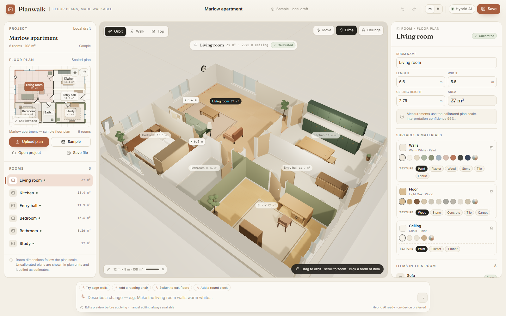

# Planwalk

**Floor plans, made walkable.** Planwalk turns a building plan into an editable,
dimension-aware 3D space. Start with the built-in apartment or upload a plan,
set its real-world scale, review the interpreted layout, then explore, measure,
furnish, and describe changes in everyday language.



Built with Vite, Three.js, and Firebase AI Logic hybrid inference.

## Run

The fastest route on Windows: double-click **`start-planwalk.cmd`**. It installs
dependencies the first time, starts the dev server, and opens the browser.

Or, from this folder:

```bash
npm install
npm start
```

`npm start` serves Planwalk at **http://localhost:5180** and opens it. Keep the
terminal running while you use the app.

> **Do not double-click `index.html`.** Planwalk is a Vite app whose JavaScript
> is loaded as modules; browsers block that over `file://`. It must be served
> over HTTP. If you open the file directly, the app now shows setup instructions
> instead of a blank page.

If port 5180 is already busy, Vite prints the alternative URL it chose — open
that URL. You can also use:

```bash
npm run dev -- --port 5173
```

Production build:

```bash
npm run build     # outputs dist/
npm run preview   # serves the build over HTTP
```

## What works

- **Immediate sample** — the Marlow apartment (six rooms, doors, windows,
  materials, furniture, a clock) opens with no setup.
- **2D + 3D working views** — select rooms or objects from the plan or the 3D
  model; orbit, top-down, and first-person walkthrough views. In walk mode use
  the mouse to look and `WASD`/arrow keys to move; `Esc` releases the pointer
  and then exits.
- **Measurements** — length, width, ceiling height, area, room-span overlays,
  and selected-object dimensions. Metric/imperial switching. Status labels
  distinguish calibrated scale, estimated outlines, and manually edited
  dimensions.
- **Materials** - wall, floor, and ceiling palettes plus custom colours and
  independent texture choices (paint, plaster, timber, stone, tile, carpet,
  fabric), applied to the generated 3D surfaces and the 2D plan. Wall colours
  are rendered per room, including both faces of shared walls.
- **Furniture and decor** - a 28-piece starter catalog with distinctive
  silhouettes, including sofas, chairs, beds, tables, storage, lighting,
  plants, rugs, wall art, mirrors, and clocks. Add, drag in the plan, drag with
  the 3D **Move** tool, nudge with arrow keys, rotate, duplicate, and remove.
  Item finishes can also use a texture (woven, wood, stone, or metal).
  Collisions and wall crossings are blocked with feedback. Wall-mounted decor
  slides along its wall in both views.
- **Natural-language edits** — prompts are turned into a structured, previewed
  edit plan with explanation. Apply or discard; every applied change is
  undoable. Example:
  - “Make the living room walls warm white, change the floor to light oak, and add a navy sofa.”
  - “Put a queen bed in the main bedroom and rotate it toward the window.”
  - “Make the kitchen cabinets matte black and add brass handles.”
  - “Change all floors to light oak.”
  - “Add a round clock above the living-room sofa.”
- **Plan upload** - PNG/JPEG/WebP, or a PDF page rasterised locally in the browser.
  Draw two points on a known distance to calibrate scale (or explicitly skip and
  keep plan-unit estimates). Review and correct room names, outlines, positions,
  wall openings, and doors/windows before opening the 3D scene. Porches, garages
  and other outdoor areas are left out of the 3D model; use one floor per image.
- **Local-first persistence** — draft state is kept in `localStorage`; **Save**
  downloads an explicit `*.planwalk.json` file (including the plan image).
  **Open project** loads one.
- **Undo/redo** — toolbar buttons, `Ctrl/Cmd+Z`, `Shift+Ctrl/Cmd+Z`, and toast
  actions.

## Firebase AI Logic (optional)

Everything above works without Firebase. AI is used only when it is configured
and available, and the app never fabricates an AI response.

1. Create a Firebase project and enable **AI Logic** in the Firebase console.
2. Register a web app and copy its web-app config.
3. In Planwalk open **AI · Setup** and paste the config JSON, or create
   `.env.local` from `.env.example` and set `VITE_FIREBASE_CONFIG`. Browser
   settings take precedence over build-time settings.
4. Enable and enforce **App Check** for AI Logic. For localhost, set
   `"debugAppCheck": true`; Planwalk generates a stable debug token and shows it
   in AI settings. Copy it into **App Check → Apps → Manage debug tokens**, then
   reload. No reCAPTCHA Enterprise key is needed for local debug mode. For
   production, remove `debugAppCheck`, add `"recaptchaSiteKey"`, and use a real
   App Check attestation provider.

Text edits use `InferenceMode.PREFER_ON_DEVICE` when the local model is
available. Plan images use `InferenceMode.PREFER_IN_CLOUD` with the configured
cloud vision model (`gemini-4-hydrogen` by default), because the cloud vision
model recognizes rooms, walls and openings more reliably than the local model. `initializeDeviceModel()` is called
after a user action and before the first local request. On-device inference
requires desktop Chrome 148+ (the Prompt API is stable there) and the Gemini Nano
model downloaded; check `chrome://components` for **Optimization Guide On Device
Model**. The app shows preparation/download progress without blocking editing.
Text edits fall back to cloud automatically when the local model is unavailable.

Every AI response reports the SDK-provided `inferenceSource` in the preview and
the AI chip: **On this device**, **Cloud fallback** for text, or **Cloud vision**
for plans. If the SDK doesn't report one, the UI says so rather than guessing.

Cloud requests require explicit opt-in. Before plan interpretation the consent
dialog lists the plan image and data sent and explains that plan images use the
cloud vision model. Text edits use the device model when it is ready; if they
fall back, only the prompt and minimal room/object context are sent (no plan
image). PDF pages are rasterised locally before the JPEG is sent.

AI output is treated as a proposal. IDs, room references, catalog types, and
colours are validated against the current scene before an edit reaches the
preview. Nothing is applied silently, and failed requests leave the scene
unchanged.

## Data and measurement semantics

Projects are plain serialisable JSON: project, plan reference, rooms, openings,
objects, materials, and history-independent scene state. Three.js meshes are
generated from this data, never the source of truth.

- Plan coordinates are stored in **plan units**.
- The project scale converts plan units to metres. The sample is authored so
  one plan unit is one metre.
- Without calibration, dimensions are shown in **plan units (`u`)** and labelled
  as estimates; they are never presented as verified construction measurements.
- Ceiling heights and furniture dimensions are real-world metres regardless of
  plan scale.
- AI-derived room outlines keep an **Estimated** status even after scale
  calibration. Editing dimensions marks the outline as **Manually edited**.
- Room interpretation confidence is displayed separately from measurement
  status.

## Keyboard

| Action | Key |
| --- | --- |
| Orbit view | `V` |
| Walk view | `W` |
| Top view | `T` |
| Walk movement | `W A S D` / arrow keys |
| Look around | Mouse (click the model to capture) |
| Release pointer lock | `Esc` |
| Exit walkthrough | `Esc` again, or the Exit button |
| Undo / redo | `Ctrl/Cmd+Z` / `Shift+Ctrl/Cmd+Z` |
| Nudge selected object (2D focused) | Arrow keys |
| Delete selected object (2D focused) | `Backspace` / `Delete` |
| Save project file | `Ctrl/Cmd+S` |

## Project layout

```
src/
  main.js              app boot + global shortcuts
  store.js             project state, undo history, local drafts
  data/                sample project, catalog, named colours
  model/               project validation and unit conversions
  actions/             scene/design mutations, import/export
  ai/                  Firebase AI Logic, schemas, rule engine, plan interpretation
  three/               renderer, cutaway walls, furniture builders, walkthrough
  ui/                  topbar, plan canvas, inspector, composer, upload wizard, modals
```

`start-planwalk.cmd` is a Windows convenience launcher; `npm run dev` and
`npm start` are the cross-platform commands.

## Limitations

- The browser's local model is still limited to supported Chrome desktop
  builds. Text edits use it when available; plan images always use the cloud
  vision model and report that source. Other browsers use Firebase-managed cloud
  inference for both and show that source honestly.
- Firebase cloud inference requires App Check to be configured in the Firebase
  console; it is a project-level setup step, not something the app can bypass.
- 2D rooms are axis-aligned rectangles (a deliberate v1 constraint). The review
  step lets you correct position and size, add/remove rooms, edit wall presence,
  and edit or remove openings.
- AI plan interpretation is a helpful starting point, not a construction
  survey. Always review the layout and calibrate against a known distance.
- The 3D orbit view uses a cutaway wall clip so interiors remain visible; walk
  mode restores full walls and ceilings.
